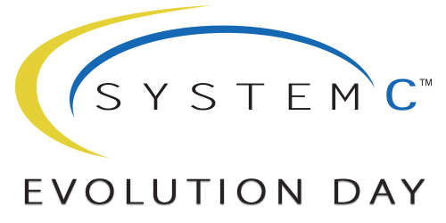
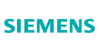
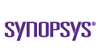

toc: false

# SystemC Evolution Day 2026 

**Workshop on the Evolution of SystemC Standards: 19 November 2026**

The 11th SystemC Evolution Day is a full-day, technical workshop on the evolution of SystemC standards to advance the SystemC ecosystem. In several in-depth sessions, selected current and future standardization topics around SystemC will be discussed in order to accelerate their progress for inclusion in Accellera and IEEE standards.

SystemC Evolution Day is intended as a lean, user-centric, hands-on forum bringing together experts from the SystemC user community and the Accellera Working Groups to advance SystemC standards.

## Event information

Date: **19 November 2026** (day after DVCon Europe 2026) 
Time: **09:30 - 17:00 CEST** 
Location: Holiday Inn Munich City Centre, Hochstrasse 3, 81669 Munich, Germany

## Registration

* [Register here](https://dvcon-europe.org/registration-information).

## Organization Team:

 * Martin Barnasconi
 * Mark Burton, Qualcomm
 * Jerome Cornet, STMicroelectronics
 * Peter de Jager, Intel
 * Sara Vinco, Politecnico di Torino

## Program

| Time (CET) | Title | Presenter(s), Organization |
| --------------------- | ---------------- | -------------------------------- |
| 9:00 | Registration & Coffee | |
| 9:25 | Introduction | Mark Burton, SystemC Evolution Day Chair |
| 9:30 | SystemC 4.0 standardization: - Working group status - Progress and how to move it forward | Laurent Maillet-Contoz |
| 10:00 | Lessons learned from SystemC CCI Sprints *[Abstract](#ready-set-commit-lessons-from-the-first-systemc-sprint)* | Lukas Jünger, MachineWare |
| 10:15 | SystemC-AMS Standardization update | Karsten Einwich, COSEDA Technologies |
| 10:35 | Coffee Break | |
| 11:00 | SystemC High-Level Synthesis News and Public Review | Frederic Doucet, Qualcomm |
| 12:00 | Lunch | |
| 13:30 | SystemC and the use of AI (Open discussion) | Moderators: Mark Burton, Martin Barnasconi |
| 14:00 | Where Did My SC_THREAD Go? Better SystemC Debugging with scGDB *[Abstract](#where-did-my-sc_thread-go-better-systemc-debugging-with-scgdb)* | Lukas Jünger, MachineWare |
| 14:30 | Lessons from practical implementation of SystemC based virtual prototypes for automotive simulation and software development | Liam Perreault, Hayden Cao, Ulises Gutierrez, Ravi Subrahmanyan |
| 15:00 | Coffee Break | |
| 15:30 | Federated Simulation Standard (FSS) and SystemC: hands-on with actual code | Mark Burton, Qualcomm |
| 16:30 | Closure | Mark Burton, SystemC Evolution Day Chair |

### Abstracts

#### Ready, Set, Commit! Lessons from the First SystemC Sprint

One of the SystemC community's biggest bottlenecks is too little work on the proof-of-concept implementations. The first SystemC Sprint, a one-day online "Bring Your Own Issue" coding event, brought engineers from industry and academia together to tackle that directly. This talk shares the results and invites you to join the next sprint.

#### Where Did My SC_THREAD Go? Better SystemC Debugging with scGDB

Debugging SystemC simulations with GDB is painful: the debugger knows nothing about SystemC's co-routine-based processes, so inspecting suspended threads or making sense of complex model types quickly turns into guesswork. scGDB is a GDB extension from MachineWare that makes the debugger aware of SystemC processes and adds pretty printers for VCML types. This talk demonstrates how scGDB simplifies everyday debugging of SystemC models and Virtual Platforms.

## Contact us

[systemc-evolution-day@lists.accellera.org](mailto:systemc-evolution-day@lists.accellera.org)
     
### Special thanks to the SystemC Evolution Day event sponsors:

[wg]:  https://workspace.accellera.org/document/dl/14079
[ch]: https://workspace.accellera.org/document/dl/14080
[fss]: https://workspace.accellera.org/document/dl/14081
