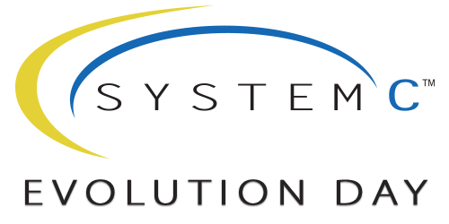
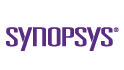

toc: false

# SystemC Evolution Day 2026 

**Workshop on the Evolution of SystemC Standards: 19 November 2026**

The 11th SystemC Evolution Day is a full-day, technical workshop on the evolution of SystemC standards to advance the SystemC ecosystem. In several in-depth sessions, selected current and future standardization topics around SystemC will be discussed in order to accelerate their progress for inclusion in Accellera and IEEE standards.

SystemC Evolution Day is intended as a lean, user-centric, hands-on forum bringing together experts from the SystemC user community and the Accellera Working Groups to advance SystemC standards.

## Event information

Date: **19 November 2026** (day after DVCon Europe 2026) 
Time: **09:00 - 16:30 CET** 
Location: Holiday Inn Munich City Centre, Hochstrasse 3, 81669 Munich, Germany 
*In-person event only*

## Registration

* [Register here](https://dvcon-europe.org/registration-information)

## Organization Team:

 * Martin Barnasconi
 * Mark Burton, Qualcomm
 * Jerome Cornet, STMicroelectronics
 * Peter de Jager, Intel
 * Sara Vinco, Politecnico di Torino

## Program

| Time (CET) | Title | Presenter(s), Organization |
| --------------------- | ---------------- | -------------------------------- |
| 9:00 | Registration & Coffee | |
| 9:25 | Introduction | Mark Burton, SystemC Evolution Day Chair |
| 9:30 | SystemC 4.0 standardization: - Working group status - Progress and how to move it forward | Laurent Maillet-Contoz |
| 10:00 | Lessons learned from SystemC CCI Sprints *[Abstract](#ready)* | Lukas Jünger, MachineWare |
| 10:15 | SystemC-AMS Standardization update | Karsten Einwich, COSEDA Technologies |
| 10:35 | Coffee Break | |
| 11:00 | Announcing the Public Review of the Accellera SystemC HLS Standard 2.0 and the Communication Library *[Abstract](#hls)*  | Frederic Doucet, Qualcomm Ramanan Radhakrishnan, Cadence Russ Klein, Siemens EDA |
| 12:00 | Lunch | |
| 13:30 | SystemC and the use of AI (Open discussion) | Moderators: Mark Burton, Martin Barnasconi |
| 14:00 | Where Did My SC_THREAD Go? Better SystemC Debugging with scGDB *[Abstract](#debug)* | Lukas Jünger, MachineWare |
| 14:30 | Lessons from practical implementation of SystemC based virtual prototypes for automotive simulation and software development *[Abstract](#lessons)*  | Liam Perreault, Hayden Cao, Ulises Gutierrez, Ravi Subrahmanyan, Analog Devices |
| 15:00 | Coffee Break | |
| 15:30 | Federated Simulation Standard (FSS) and SystemC: hands-on with actual code | Mark Burton, Qualcomm |
| 16:30 | Closure | Mark Burton, SystemC Evolution Day Chair |

 
## Abstracts

**Ready, Set, Commit! Lessons from the First SystemC Sprint**

*Presenter: Lukas Jünger, MachineWare*

One of the SystemC community's biggest bottlenecks is too little work on the proof-of-concept implementations. The first SystemC Sprint, a one-day online "Bring Your Own Issue" coding event, brought engineers from industry and academia together to tackle that directly. This talk shares the results and invites you to join the next sprint.

**Announcing the Public Review of the Accellera SystemC HLS Standard 2.0 and the Communication Library**

*Presenters: Frederic Doucet, Qualcomm Ramanan Radhakrishnan, Cadence Russ Klein, Siemens EDA*

This presentation introduces the new Accellera SystemC HLS Standard 2.0 and the Communication Library for public review. The updated standard broadens its scope beyond syntax to address how SystemC constructs are interpreted for high-level synthesis (HLS). It also adds a new HLS library that simplifies throughput-accurate modeling for system and hardware designers. The presentation examines the underlying code and implementation techniques that make these modeling capabilities possible.

**Where Did My SC_THREAD Go? Better SystemC Debugging with scGDB**

*Presenter: Lukas Jünger, MachineWare*

Debugging SystemC simulations with GDB is painful: the debugger knows nothing about SystemC's co-routine-based processes, so inspecting suspended threads or making sense of complex model types quickly turns into guesswork. scGDB is a GDB extension from MachineWare that makes the debugger aware of SystemC processes and adds pretty printers for VCML types. This talk demonstrates how scGDB simplifies everyday debugging of SystemC models and Virtual Platforms.

**Lessons from practical implementation of SystemC based virtual prototypes for automotive simulation and software development**

*Presenters: Liam Perreault, Hayden Cao, Ulises Gutierrez, Ravi Subrahmanyan, Analog Devices*

As automotive networks increase in complexity, software is becoming an increasingly important part of the development process for these systems. In this work, we present the design of virtual prototypes using SystemC for ADI’s E2B (Ethernet to Edge Bus) family of devices. Using these virtual prototypes in a system-level design allows earlier software development, faster simulation speed than RTL, and easier debugging.

E2B products are edge devices in an automotive network that implement a remote control protocol, replacing the need for microcontrollers at the edge. Multiple E2B devices in a vehicle network can be controlled over ethernet using a central software system, allowing the control of peripheral devices such as lighting assemblies or motors. To control the peripheral devices, the central (host) software must be able to configure the E2B device appropriately, send ethernet packets to the E2B device to control peripherals over other interfaces, such as UART, and interpret responses generated by the E2B device. These devices must be modeled accurately from a software perspective to enable validation of this host software in simulation.

These models have several I/O interfaces connected to other device models, and therefore behaviorally accurate processing and formatting of this data was required. To ensure software sets up the device correctly, key configuration options had to be modeled. These models are to be used in system-level simulations, so the model must be compatible with the customer’s simulation environment. Finally, as this system-level simulation would include several devices, the speed of simulation matters, and an RTL-level model would be too slow and detailed for a large-scale simulation.

To develop this model, the device specification and RTL were used as a functional reference; however, the modeling behavior may be modeled at a different level of abstraction than the device. Based on requirements for functional software development, the model largely simplifies the device behavior compared to the RTL. We present how this is done through modeling behavior at the transaction level and not including exact or approximate timing for most transactions. This modeling approach was also applied to co-simulation with a processor model using Renode, although this will not be the focus of this talk. We discuss benefits of this modeling approach, such as more flexibility to microarchitecture changes, and limitations, such as the model not being usable for precise performance analysis and additional flexibility required by host software to account for timing differences. Additionally, modeling this in software allows additional logging
information, which can be used when debugging host software, but may not be visible in a hardware-only approach.

The approach taken to integrate the core SystemC model into the customer’s environment is that the model has a wrapper added to it to make it compatible with the target simulation framework. Integration into other frameworks is possible using a similar mechanism, and Accellera’s FSS effort is of interest in this regard, from our perspective as model creators who need to interface into various user environments. For the use case described here, a wrapper for the FMI standard was added to the model, as this is commonly used in automotive simulations. This provides a standard API to interact with the model and allows co-simulation of different models, even if they do not use SystemC as the core model. We show how this enables the integration of the E2B device into a sample customer system. We present additional requirements to be able to co-simulate our model, including format standardization of each I/O interface and other model timing-related considerations when using this simulation framework. Finally, we will show results comparing simulation speeds between the SystemC model and RTL for a network containing multiple E2B devices.

 
## Contact us

[systemc-evolution-day@lists.accellera.org](mailto:systemc-evolution-day@lists.accellera.org)
     

### Special thanks to Accellera Global Sponsors

